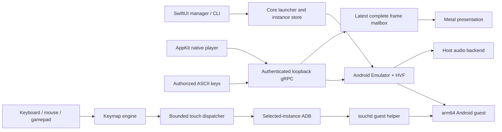

# Architecture

Kestrel is an original Swift/AppKit/SwiftUI host application around Google's Android Emulator. It does not contain a new CPU virtualization engine or a redistributed commercial emulator. The source paths below are the implementation reference; [research](../research/README.md) explains the decisions and evidence.

## Modules

| Component | Responsibility |
|---|---|
| `KestrelApp` | SwiftUI instance manager, settings, apps, mapping selection and session orchestration |
| `KestrelCore` | Instance storage/configuration, SDK setup, launcher, snapshots, bounded subprocesses, discovery and authentication policy |
| `KestrelStream` | Wire-compatible emulator gRPC calls, authenticated screenshot/frame stream and keyboard messages |
| `KestrelPlay` | Native AppKit window, Metal frame presentation, input dispatch, overlay editor, focus handling and session lifecycle |
| `KestrelKeymap` | Codable mapping model, key names, editing operations, deterministic touch engine, scripts and recording |
| `kestrel` | CLI entry point into the same core services |
| `touchd` | Original Android helper delivering multitouch events through touchscreen/uinput facilities |
| `diagnostics` | Original workloads, measurements, fixture programs and controlled experiment runners |

## Virtual machine and guest selection

The emulator supplies QEMU-based virtual devices, Hypervisor.framework acceleration and graphics translation. Kestrel requests an arm64 Google Play image, currently Android 16/API 36. SDK packages are external installations; their licenses and update cadence are not governed by Kestrel's MIT license.

[Instance.swift](../../Sources/KestrelCore/Instance.swift) creates the AVD and settings. Index `n` maps to console port `5580 + 2n`, its adjacent ADB port and serial `emulator-<console>`. Alternative diagnostic ports must be explicitly isolated. [Launcher.swift](../../Sources/KestrelCore/Launcher.swift) builds arguments from settings and owns stop behavior.

Host window scaling is separate from guest resolution. [DiskCapacity.swift](../../Sources/KestrelCore/DiskCapacity.swift) preserves the larger of requested capacity and existing virtual disk capacity when regenerating configuration; it reads bounded headers rather than resizing userdata.

## Native video and authentication

The native path runs the emulator without its own window. It discovers an endpoint for the owned process, verifies the listener is loopback and requires advertised JWT authentication. A per-session P-256 signing key remains in memory; its public JWK is registered with the emulator and removed on disconnect. ES256 tokens authorize individual RPC paths and have short lifetimes.

The explicit player methods are `getScreenshot`, `streamScreenshot`, and `sendKey`. Registration of a public key is not permission to expose the gRPC port publicly. See [EmulatorTokenSigner.swift](../../Sources/KestrelCore/EmulatorTokenSigner.swift) and [EmulatorFrameClient.swift](../../Sources/KestrelStream/EmulatorFrameClient.swift).

Frames are requested as RGBA8888, validated and copied into complete `PlayerFrame` values. The mailbox retains the latest pending frame rather than building a latency queue. The Metal renderer uploads an RGBA texture and presents into a BGRA target, preserving aspect ratio and bounding in-flight work. Stream generations prevent late frames from an old connection replacing the current one. Token renewal and reconnect behavior have dedicated tests and probes.

Shared-memory streaming was measured, but lacking a demonstrated producer fence means raw memory access does not establish tear-free ownership. The production design favors complete frame copies and bounded backlog. This is not a claim of zero-copy rendering or zero latency.

## Pointer, mapped touches and focus

The selected instance's ADB transports a persistent helper connection. `touchd` uses Linux multitouch protocol B through available touchscreen/uinput facilities; it is not a kernel-root exploit. The helper is named `sec_touchd` in the guest. Naming does not change game detection guarantees.

The mapping engine transforms normalized controls into ordered down/move/up operations with bounded touch-slot ownership. Radius uses guest width; Y movement accounts for aspect ratio. Joystick `travel` multiplies actual touch displacement independently of the editor's base ring. Walk/sprint modifiers apply further scaling.

The native controller coordinates direct pointer input, mapping input leases, replay, editor state and typing. A keymapping popover explicitly suspends gameplay, resets held touches and passes UI events through. This must also apply when mappings are enabled inside the open popover. Hints attach to the native parent window as click-through fullscreen auxiliary children; legacy external-window integration uses separate floating hints.

Source: [PlaySession.swift](../../Sources/KestrelPlay/PlaySession.swift), [NativePlayerSessionController.swift](../../Sources/KestrelPlay/NativePlayerSessionController.swift), [Engine.swift](../../Sources/KestrelKeymap/Engine.swift), [touchd.c](../../touchd/touchd.c).

## Text input

Guest editor observation reads window/input-method/window state with an aggregate freshness budget. The coordinator authorizes keyboard requests only with fresh guest and host focus, invalidates them on transitions, and requires gameplay to relinquish input first. The queue expands ASCII text into bounded single-key requests and checks authorization for each item.

A delayed observation fails closed. This protects against sending queued text into another field, but can interrupt typing under load. Native event routing, guest transport, and Android field behavior are separate verification layers; a transport test alone does not prove all three.

## Audio and microphone

The emulator's host backend handles sound. Kestrel does not decode/play a separate gRPC audio stream. Capture evidence on the development Mac showed CoreAudio I/O activity, but that does not establish which samples reached physical speakers.

`audio=false` disables emulator audio. `microphone=true`, only with audio enabled, adds `-allow-host-audio`; otherwise the emulator does not deliberately forward the host microphone. The optional setting preserves decoding of older profiles. Runtime voice capture also depends on OS and guest permissions and was not verified for the first preview.

## Lifecycle and failure containment

An owned native session validates startup evidence, tracks readiness, streams frames, and closes input before stopping its emulator. Cancellation invalidates queued operations and credentials. Process helpers bound time and captured-output size and reap owned children. Emulator shutdown first attempts graceful mechanisms; forceful cleanup is a bounded fallback for owned processes only.

Snapshots and user disks are persistent data, not disposable build outputs. Diagnostics use isolated profiles and restore changed settings. Do not point experimental scripts at an existing user profile without reviewing their exact scope.

## Boundaries

- External emulator/SDK/system-image behavior is not fully controlled by this repository.
- Loopback authentication does not imply the entire Android environment is hardened.
- Stock image identity overrides can be ignored; no anti-cheat or attestation bypass is established.
- The app, tests and diagnostics are original work; public research excludes proprietary binaries and decompiled implementation text.

Continue with [building](building.md), [keymap format](../reference/keymap-format.md), and [research decisions](../research/experiment-ledger.md).
