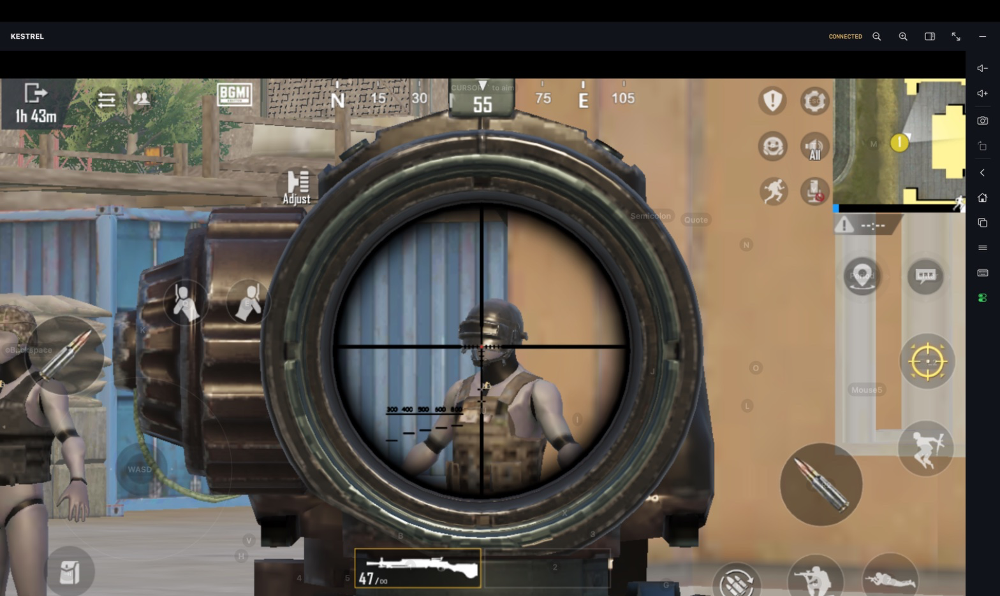

# BGMI: matching the bundled keyboard preset to your HUD

The published [`bgmi` preset](../../keymaps/bgmi.json) is a snapshot of Himansh's saved Kestrel keymap. Use the matching BGMI button layout below before testing it. A different in-game HUD can put touches on the wrong buttons even when the keymap loads successfully.



*Gameplay screenshot supplied by the maintainer; the bottom room/session identifier strip has been removed.*

## 1. Select Character control option 3

In BGMI, open **Settings → Customize Buttons → Character** and select **option 3**:

- **Left: movement (fixed button)**
- **Right: fire (fixed button)**

Then choose **Customize**. “Option 3” means the third control scheme on this settings page, **not** third-person camera mode and not a requirement to use layout slot 3. The supplied screenshot shows this scheme selected.

## 2. Import the matching BGMI HUD

Himansh's shared button-layout code:

```text
1-7685-6236-0319-5283-780
```

Use BGMI's layout-sharing/import controls in the customization screen to enter the code, preview the layout and apply/save it. The exact import labels may vary by game version. Back up or share your existing HUD before replacing it.

This is an **in-game HUD layout code**, not a Kestrel keymap import code or a sensitivity code. It was supplied by the maintainer; a fresh-account import has not been independently verified. BGMI controls whether a shared code remains valid or is compatible with a particular game version. Do not assume the same code works in every PUBG Mobile regional edition.

## 3. Select Kestrel's BGMI preset

Choose **BGMI** in Kestrel's Controls/keymap selection, then enable keymapping from the native player's right sidebar. The bundled preset targets `com.pubg.imobile` and a landscape aspect ratio of approximately **16:9**.

Leave BGMI's button-layout editor before trying movement or firing. Inside that editor, touches select or move HUD buttons rather than controlling your character.

**Existing Kestrel users:** a previously saved personal `bgmi.json` takes priority over the bundled preset. An app update deliberately does not overwrite your custom keymap. To adopt the new preset, preserve your existing file first, then import the published [`keymaps/bgmi.json`](../../keymaps/bgmi.json) using Kestrel's keymap controls. The maintainer's original saved keymap was not modified when preparing this published copy.

## Published movement settings

The current snapshot contains:

| Setting | Value |
|---|---|
| Movement | W / A / S / D |
| Joystick centre | `(0.145, 0.72)` in normalized guest coordinates |
| Joystick ring radius | approximately `0.09517` of guest width |
| Push distance (`travel`) | `1.77×` |
| Sprint modifier | Shift, `1.6×` multiplier |
| Walk modifier | Ctrl, `0.45×` multiplier |
| Sprint-lock button | K at `(0.1478, 0.4631)` |
| Toggle mouse look | Grave / backtick |
| Temporarily free cursor | Alt |

Push distance changes the emitted touch displacement; it does not change BGMI's own movement rules. The radius, travel, and sprint/walk multipliers combine. If the controls do not match your version of the imported HUD, adjust them in training ground rather than assume increasing the radius guarantees sprinting. In the live editor, select the joystick and use `[` / `]` for radius and `Shift+[` / `Shift+]` for push distance, then **Save**.

The remaining keys and exact coordinates are in the JSON. This snapshot also preserves the maintainer's `Period`, `Semicolon`, and `Quote` bindings; the latter two are unlabeled custom touch positions, not universally verified game actions.

## Contextual-key limitations

`F` is a **fixed sequence of taps** at several action positions (drive, open, pick up, exit). It does not inspect the screen or choose an action intelligently. If another active control occupies one of those positions, the sequence can trigger it. `Backspace` and `Mouse4` also use fixed macros. Review or replace these with individual bindings if they cause unwanted actions.

## Check before playing

1. Import the matching HUD and choose Character option 3.
2. Enable Kestrel's mapping and compare visible hints to the actual buttons.
3. Test movement, sprint, aim, fire, reload, jump and contextual actions in training ground.
4. Adjust only the controls that miss and save your personal copy.

Schema validation proves the JSON can be loaded; it does not prove that every action works in every match. Report a mismatch with the game version, selected scheme, guest resolution and a screenshot without private account information.

See also: [User guide](user-guide.md), [Compatibility](compatibility.md), and [BGMI graphics case study](../research/bgmi-case-study.md).
